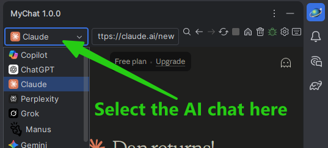
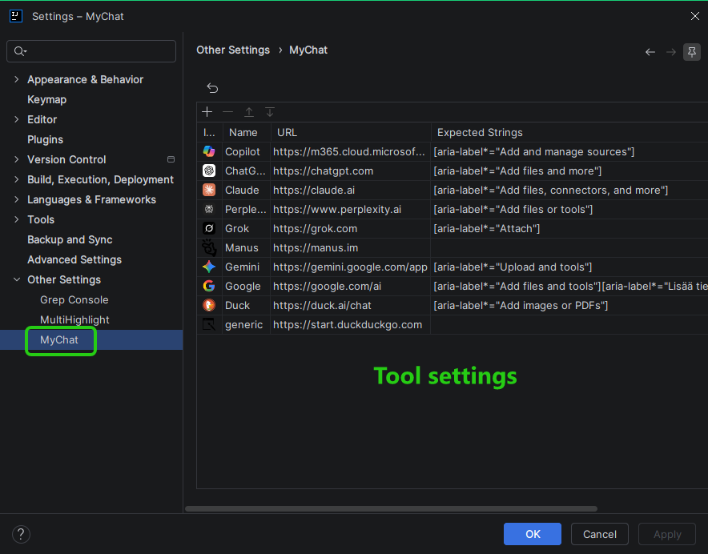
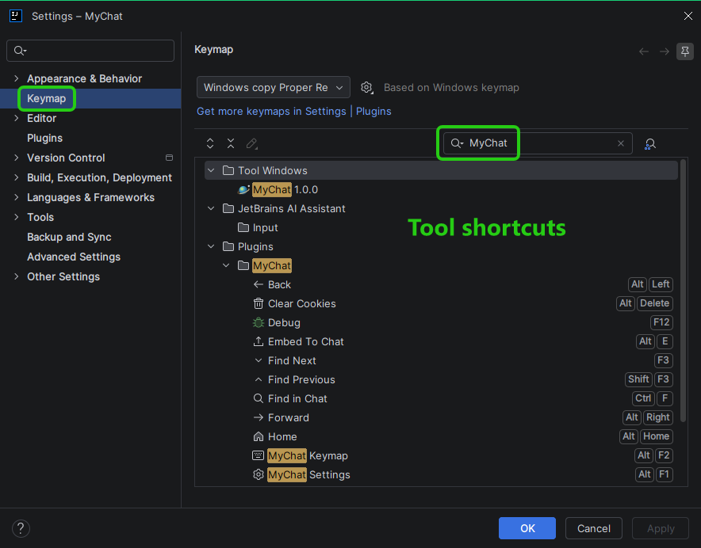

# MyChat

MyChat is an IntelliJ IDEA plugin that integrates popular AI chat services (like ChatGPT, Claude, Copilot, Gemini, and more) directly into your IDE via a tool window. It enables seamless integration between your code and AI assistants, allowing you to send files or code selections to the chat with a single click.

## Architecture Overview

The plugin is built using the **IntelliJ Platform SDK** and leverages **JCEF (Java Chromium Embedded Framework)** to host a fully functional browser within the IDE.

### Key Components

- **`MyChatWindow`**: The central UI component that hosts the `JBCefBrowser`. It manages browser lifecycle, site navigation, and custom UI elements like the Find Bar.
- **`ComponentUtils` & `JsUtils`**: These utilities handle the core "integration" logic. They use JavaScript injection to interact with the web pages of AI services, enabling features like file uploads and text injection that are not natively supported by a simple browser view.
- **`MyChatSettings`**: A persistent settings component that stores the list of supported AI sites, their names, and URLs.
- **`MyChatStartupActivity`**: Ensures JCEF is safely initialized post-startup and manages cookie persistence.
- **`BrowserLocator`**: A utility to reliably find the active browser instance across different contexts in the IDE.
- **Actions**: A collection of actions (in `com.example.actions`) that provide browser control (back, forward, refresh, home, stop), cookie management, and integration features (`Send To`, `Embed To`).

### Integration Mechanism (JavaScript Injection)

Since AI chat websites are designed for human interaction via a standard browser, MyChat uses sophisticated JavaScript injection to automate tasks:
1. **File Injection**: When "Send To" is used, the plugin creates `File` blobs in the browser's context and simulates a `DataTransfer` event (similar to a drag-and-drop operation) to upload files. It supports file size limits (10B to 5MB) and site-specific transformations (e.g., converting unsupported file types for Copilot).
2. **Text Embedding**: For "Embed To", the plugin identifies the chat's input area using a set of common CSS selectors and injects formatted Markdown directly into the text field.

## Project Structure

- `src/main/kotlin/com/dapa1/`
    - `actions/`: IDE actions for browser navigation and file/content integration.
    - `browser/`: Browser instance management and data keys.
    - `services/`: Project-level state management.
    - `settings/`: Plugin configuration, site definitions, and settings UI.
    - `ui/`: Tool window implementation, theme listeners, and the find bar.
    - `utils/`: Utilities for JCEF, JS injection, MIME types, and file handling.
- `src/main/resources/`
    - `META-INF/`: `plugin.xml` (the plugin manifest defining all components and actions).
    - `js/`: JavaScript templates for browser-side logic.
    - `icons/`: SVG icons for the tool window and supported AI services.
    - `messages/`: Localization bundles.

## Getting Started

### Prerequisites
- IntelliJ IDEA 2026.2+.
- JDK 25+.

### Building and Running
1. Open the project in IntelliJ IDEA.
2. Run the `Run Plugin` configuration (or execute `./gradlew runIde`).
3. The MyChat tool window will appear on the right side of the IDE.

### Debugging
- Press `F12` while the MyChat window is focused to open the **CEF DevTools**.
- Check `HINTS.md` for advanced tips on JCEF logging and remote debugging.

## Technical Limitations

- **Browser Find Bar**: The current implementation of the inline search bar does not show real-time match counts (e.g., "1/5") due to limitations in the version of JCEF available in the target IntelliJ platform.
- **Site Compatibility**: JavaScript injection depends on CSS selectors. If an AI service updates its website layout, injection might require an update in `ComponentUtils.kt`.
